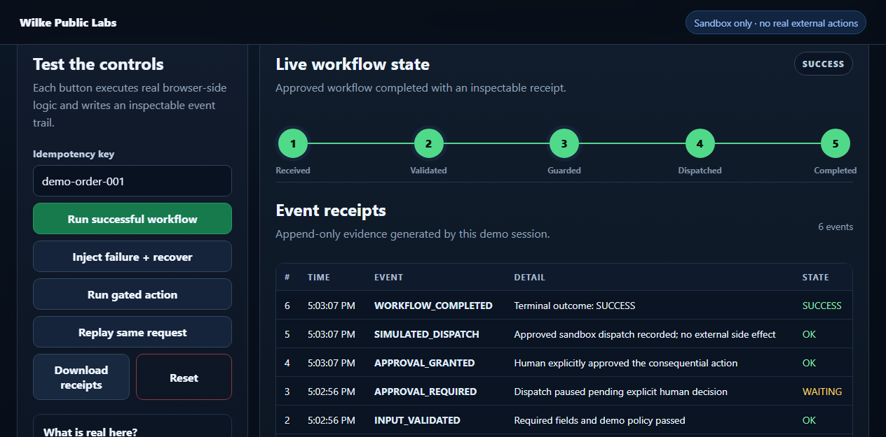

# Wilke Public Labs

[](https://github.com/itsmeb-lab/wilke-public-labs/actions/workflows/verify.yml)

Public, inspectable capability demos for automation, workflow reliability, and AI-assisted systems.

**One API, webhook or lead-form problem?** [See the $150 USD diagnostic scope](https://wilkeservices.com/software-diagnostic?utm_source=wilke_public_labs&utm_medium=referral&utm_campaign=software_diagnostic&utm_content=repository_readme). The one-time package covers one agreed JavaScript/Node.js issue: safe reproduction, focused tests, repair notes and one clarification. Implementation is separate. Inquiry first; there is no checkout in this repository.

## Why this repository exists

Freelance profiles and claims are weak evidence. This repository is the opposite: small runnable demos with source code, explicit truth boundaries, and reproducible tests.

## Live labs

### 01 — Automation Reliability Lab

Interactive browser sandbox demonstrating:

- deterministic workflow state transitions
- bounded retry and fallback recovery
- idempotency / duplicate suppression
- explicit human approval before consequential dispatch
- timestamped, downloadable event receipts
- safe no-side-effect sandbox behavior

**Live demo:** https://itsmeb-lab.github.io/wilke-public-labs/automation-reliability-lab/



### 02 — Windows Process Recovery Watchdog

Real PowerShell watchdog plus an interactive browser mirror demonstrating:

- start when absent
- avoid duplicate starts while healthy
- restart after crash with a fresh PID
- timestamped watchdog receipts
- fixture tests covering all three states

**Live demo:** https://itsmeb-lab.github.io/wilke-public-labs/windows-process-recovery-watchdog/

**Public lab index:** https://itsmeb-lab.github.io/wilke-public-labs/

### 03 — Published Policy Lab

A source-linked checker for selected recycling, notary, printing, borrowing, room-use and mulch tasks at selected sample places and programs across three states. It preserves exclusions, unknown details and the difference between published schedules and live availability. No upload, account, payment or added analytics.

**Live page:** https://itsmeb-lab.github.io/wilke-public-labs/published-policy-lab/

See [scope, sources and update procedure](./published-policy-lab/README.md).

### 04 - Repair Café Visit Planner

Compare item rules and check-in instructions at seven repair café programs in the United States, Canada, the United Kingdom and Australia. The [visit planner](https://itsmeb-lab.github.io/wilke-public-labs/repair-cafe-planner/) works without JavaScript. See the [source catalog and update procedure](./repair-cafe-planner/README.md).

### 05 - Animal Shelter Linen Donation Guide

Compare what seven shelters publish about linen donations and find their drop-off instructions. The [guide](https://itsmeb-lab.github.io/wilke-public-labs/shelter-linen-guide/) groups rules by item and keeps animal-care drop-off separate from resale. See the [source catalog and update procedure](./shelter-linen-guide/README.md).

### 06 - Bulky Pickup and Drop-Off

Compare municipal routes for common items and cleanout loads in the City of Milwaukee and the City of Wauwatosa. See the [bulky item guide](https://itsmeb-lab.github.io/wilke-public-labs/milwaukee-bulky-items/) and its [reviewed sources](./milwaukee-bulky-items/README.md).

### 07 - Food-Scrap Drop-Off

Compare five materials across six named public drop-off programs, including raw meat, brown paper bags and certified compostable liners. Open the [food-scrap guide](https://itsmeb-lab.github.io/wilke-public-labs/food-scrap-drop-off/) or the [source catalog](./food-scrap-drop-off/README.md).

### 08 - Library Document Scanning

Compare scanning methods, library card requirements and scanner sizes at seven libraries. Open the [guide](https://itsmeb-lab.github.io/wilke-public-labs/library-scanning/) or its [source data](./library-scanning/README.md).

### Library museum passes and timed tickets

Check when the library pass and venue ticket are separate, where to redeem the pass and whether a physical pass needs to be returned. Open the [museum pass guide](https://itsmeb-lab.github.io/wilke-public-labs/library-museum-passes/) or its [source data](./library-museum-passes/README.md).

## Run locally

```bash
npm test
python -m http.server 8080
```

Then open a lab:

- `http://localhost:8080/automation-reliability-lab/`
- `http://localhost:8080/windows-process-recovery-watchdog/`
- `http://localhost:8080/published-policy-lab/`
- `http://localhost:8080/repair-cafe-planner/`
- `http://localhost:8080/shelter-linen-guide/`
- `http://localhost:8080/milwaukee-bulky-items/`
- `http://localhost:8080/milwaukee-articulos-voluminosos/`
- `http://localhost:8080/milwaukee-cleanout-floor-handoff/`
- `http://localhost:8080/food-scrap-drop-off/`
- `http://localhost:8080/library-scanning/`
- `http://localhost:8080/library-museum-passes/`
- `http://localhost:8080/library-seed-borrowing/`
- `http://localhost:8080/tool-library-borrowing/`
- `http://localhost:8080/library-sensory-spaces/`
- `http://localhost:8080/eyeglass-donation-rules/`
- `http://localhost:8080/guide-finder/`
- `http://localhost:8080/comparison-data/`

See [how to verify the public comparisons and trace a source change](./COMPARISON-MAINTENANCE.md).

## Windows watchdog fixture

On Windows PowerShell:

```powershell
.\windows-process-recovery-watchdog\powershell\Test-ProcessWatchdog.ps1
```

## Truth boundary

These are public capability demonstrations, not paid-client production deployments, customer data, or claims of external ROI. External side effects in browser labs are deliberately simulated.

## Public-safety boundary

This repository is intentionally separate from private Wilke ecosystem repositories. It must not contain:

- credentials, tokens, cookies, or secrets
- customer or prospect private data
- private architecture or internal controller state
- absolute workstation paths
- private email addresses
- proprietary source copied from private repositories without review

## Work with me

Start with the [diagnostic scope and free handoff checklist](https://wilkeservices.com/software-diagnostic). Review the explicitly [fictional sample handoff](https://wilkeservices.com/downloads/api-webhook-diagnostic-sample.txt) before discussing a project. Written scope, permitted access, timing and payment arrangements are agreed before work begins. This diagnostic does not include Windows administration or production implementation.

Found these labs through Upwork? Keep pre-contract discussion and payment in the existing Upwork conversation. Do not use the direct-site contact route to move a marketplace relationship off-platform.

The [public sitemap](https://itsmeb-lab.github.io/wilke-public-labs/sitemap.xml) lists the eighteen published pages. Its presence and the pages' metadata do not prove search indexing, visitors or conversions.

## License

MIT. See [LICENSE](./LICENSE).
